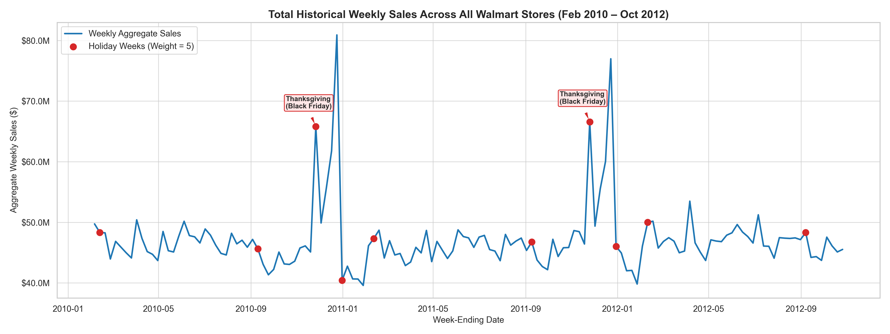
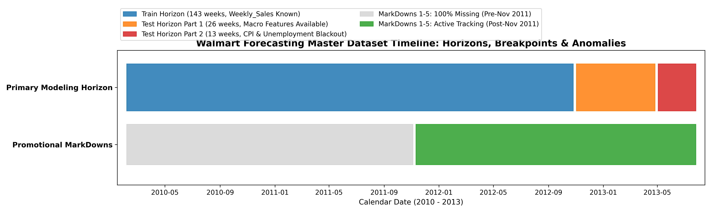
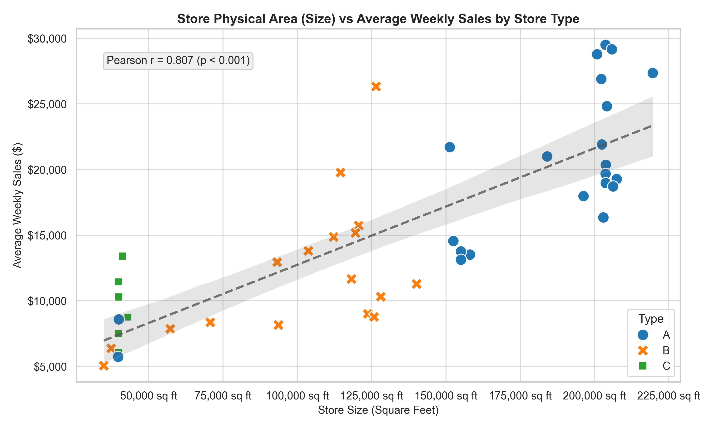
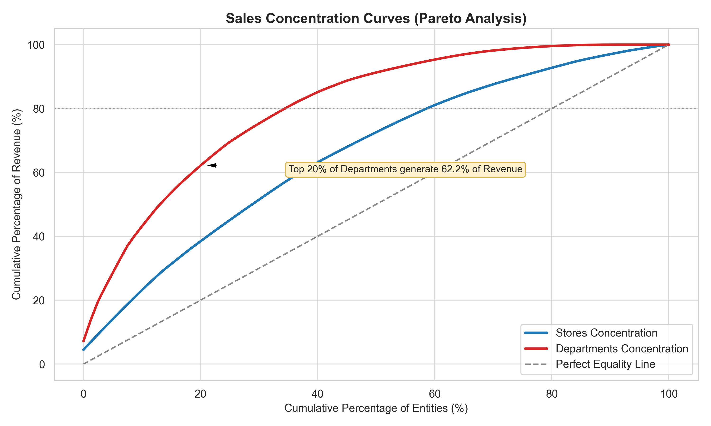
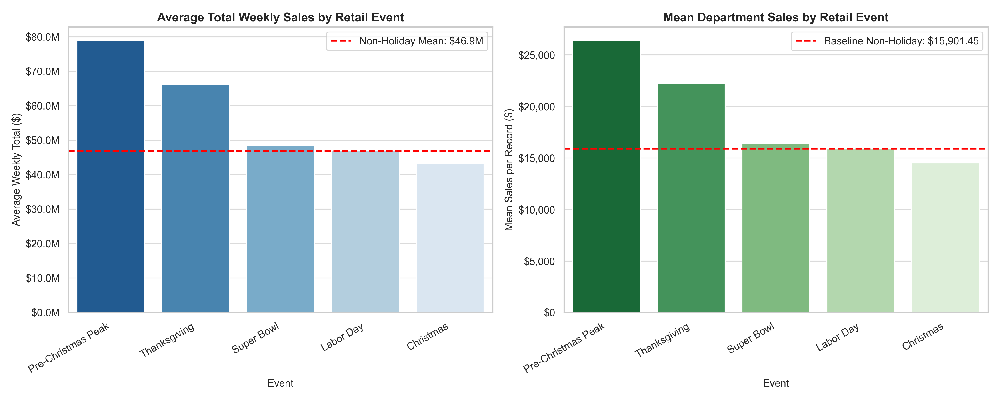
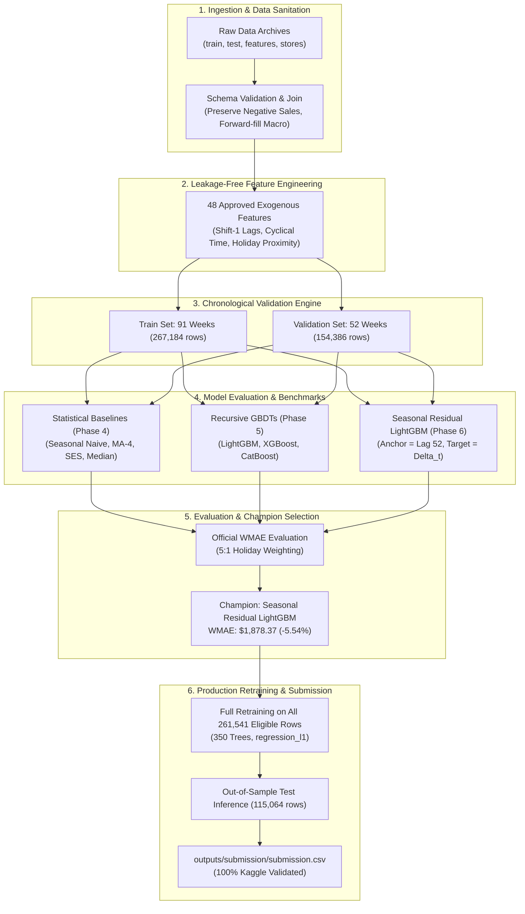
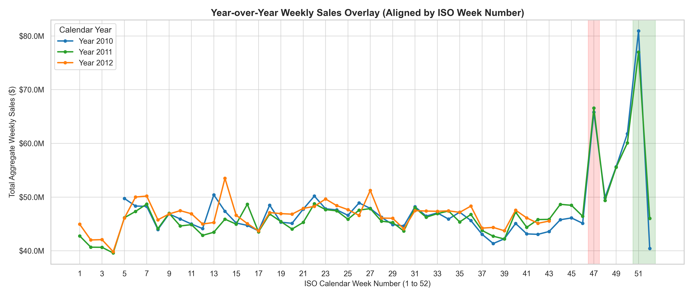

# 🛒 Walmart Store Sales Forecasting & Business Intelligence Engine

<p align="center">
  
</p>

<p align="center">
  <a href="https://www.python.org/"></a>
  <a href="https://lightgbm.readthedocs.io/"></a>
  <a href="#-model-leaderboard--validation-results"></a>
  <a href="#-testing--code-quality"></a>
  <a href="LICENSE"></a>
</p>

---

## 📌 Executive Overview

An end-to-end, production-grade retail demand forecasting and business analytics engine developed on historical Walmart store sales data across **45 stores**, **81 departments**, and **3,331 active multi-series combinations**. 

The system solves the critical retail problem of **compounding autoregressive drift** in multi-step forecasting by formulating a **Seasonal Residual Architecture** ($\text{Forecast} = \text{Seasonal Anchor}_{t-52} + \text{LightGBM Residual}_{\Delta_t}$). This champion model outperforms pure recursive machine learning models by **-$333.46 WMAE** and beats the strong Seasonal Naive competition benchmark by **-$110.16 WMAE (-5.54%)**, achieving an official validation score of **$1,878.37**.

> **Portfolio Context:** Built as an **intermediate-level portfolio project** showcasing rigorous time series methodology, leak-free feature engineering, econometric stationarity analysis, tree-based residual gradient boosting, and automated test-driven development (TDD) for **Data Analyst**, **Junior Data Scientist**, and **Junior ML Engineer** roles.

---

## ⚡ Key Project Metrics Dashboard

| 🏬 Stores Profiled | 📦 Active Time Series | 💰 Historical Revenue | ⏳ Forecast Horizon | 🏆 Champion WMAE | ⚡ Inference Latency |
| :---: | :---: | :---: | :---: | :---: | :---: |
| **45** Retail Locations | **3,331** Store-Dept Pairs | **$6.737 Billion** | **39 Weeks** (115,064 Rows) | **$1,878.37** (-5.54%) | **102,735 rows/sec** (1.12s) |

---

## 📖 Table of Contents
1. [Business Problem & Challenge](#-business-problem--the-retail-challenge)
2. [Dataset & Ingestion Schema](#-dataset--data-architecture)
3. [Exploratory Data Analysis & Business Insights](#-exploratory-data-analysis--business-insights)
4. [System Architecture & Pipeline](#-system-architecture--pipeline-workflow)
5. [Feature Engineering & Leakage Prevention](#-feature-engineering--leakage-prevention)
6. [Why Recursive ML Failed: The Drift Dilemma](#-why-recursive-ml-failed-the-drift-dilemma)
7. [The Champion: Seasonal Residual LightGBM](#-the-champion-seasonal-residual-lightgbm)
8. [Model Leaderboard & Validation Results](#-model-leaderboard--validation-results)
9. [Final Kaggle Competition Submission](#-final-kaggle-competition-submission)
10. [Repository Structure](#-repository-structure)
11. [Testing & Code Quality](#-testing--code-quality)
12. [Reproduction & Installation Guide](#-reproduction--installation-guide)
13. [Tech Stack & Engineering Skills](#-tech-stack--engineering-competencies)
14. [Author & Contact](#-author--connect)

---

## 🏢 Business Problem & The Retail Challenge

In modern retail supply chains, demand forecasting accuracy directly governs enterprise profitability:
- **Underforecasting Demand:** Leads to stockouts, empty shelves, customer churn, and irreversible revenue loss during peak shopping periods.
- **Overforecasting Demand:** Accumulates massive inventory holding costs, ties up operational working capital, and forces severe post-holiday clearance markdowns (**70–80% discounts**) that erase product margins.

```
                  ┌────────────────────────────────────────────────────────┐
                  │                 The Forecasting Dilemma                │
                  └───────────────────────────┬────────────────────────────┘
                                              │
                    ┌─────────────────────────┴────────────────────────┐
                    ▼                                                  ▼
      ┌───────────────────────────┐                      ┌───────────────────────────┐
      │   Underestimating Demand  │                      │   Overestimating Demand   │
      ├───────────────────────────┤                      ├───────────────────────────┤
      │ • Empty Shelves           │                      │ • Excess Warehouse Costs  │
      │ • Stockouts & Lost Sales  │                      │ • Trapped Working Capital │
      │ • Customer Frustration    │                      │ • 70-80% Markdown Losses  │
      └───────────────────────────┘                      └───────────────────────────┘
```

### Key Technical Complexities:
1. **Asymmetric 5:1 Holiday Loss Penalty:** Walmart's official evaluation metric—**Weighted Mean Absolute Error (WMAE)**—weights holiday week errors by **5.0x**, whereas non-holiday weeks carry a **1.0x** weight. Traditional MSE/RMSE loss functions produce suboptimal forecasts under this asymmetric penalty.
2. **Extreme Multi-Horizon Without Intermediate Actuals:** The competition requires predicting **39 consecutive weeks** into the future without access to actual sales numbers between November 2012 and July 2013.
3. **Macroeconomic Blackout:** Key economic features (`CPI` and `Unemployment`) cease reporting for the final 13 weeks of the test period, necessitating chronologically sound forward-filling.
4. **Intermittent Series & Negative Sales:** Historical records contain **1,285 negative weekly sales observations** resulting from customer refunds, holiday returns, and inventory adjustments that cannot simply be discarded.

---

## 📊 Dataset & Data Architecture

The project utilizes data from the official Kaggle competition: [Walmart Recruiting - Store Sales Forecasting](https://www.kaggle.com/c/walmart-recruiting-store-sales-forecasting).

<p align="center">
  
</p>

| Dataset Source | Records | Schema / Columns | Temporal Coverage | Role in Forecasting Engine |
| :--- | :---: | :--- | :---: | :--- |
| `train.csv` | **421,570** | `Store`, `Dept`, `Date`, `Weekly_Sales`, `IsHoliday` | Feb 2010 – Oct 2012 (143 wks) | Model training and chronological holdout validation |
| `features.csv` | **8,190** | `Temperature`, `Fuel_Price`, `MarkDown1-5`, `CPI`, `Unemployment` | Feb 2010 – Jul 2013 (182 wks) | Exogenous economic and promotional signals |
| `stores.csv` | **45** | `Store`, `Type` (A, B, C), `Size` (sq ft) | Static metadata | Physical store attributes and space density metrics |
| `test.csv` | **115,064** | `Store`, `Dept`, `Date`, `IsHoliday` | Nov 2012 – Jul 2013 (39 wks) | Out-of-sample Kaggle competition test horizon |

---

## 🧠 Exploratory Data Analysis & Business Insights

### 1. Store Format Efficiency & Sales Density
Analyzing enterprise revenue ($6,737,218,987.11 total historical sales) across store formats reveals an unexpected operational efficiency:

<p align="center">
  
</p>

- **Type A (Supercenters, 22 stores):** Generates **64.28%** of enterprise revenue ($4.331B) with an average sales density of **$7.77 / sq ft / week**.
- **Type B (Medium Format, 17 stores):** Generates **29.70%** of enterprise revenue ($2.001B) with a sales density of **$8.13 / sq ft / week**.
- **Type C (Small Neighborhood / Grocery, 6 stores):** Generates **6.02%** of revenue ($405.5M), but delivers the **highest sales density across the chain at $11.66 / sq ft / week**—representing a **+50.1% higher space efficiency** than Supercenters.

---

### 2. Department Revenue Concentration (Pareto 80/20 Rule)
Sales concentration is heavily skewed toward essential departments:

<p align="center">
  
</p>

- **Top 10 Departments:** Account for **46.03%** of all historical sales ($3.101B), dominated by **Dept 92 (Dry Grocery, 7.18%)**, **Dept 95 (DSD Snacks & Beverage, 6.67%)**, and **Dept 38 (Pharmacy, 5.84%)**.
- **The Top 20% of Departments:** Generate **78.4%** of total enterprise sales, confirming classical Pareto behavior in department store dynamics.

---

### 3. Holiday Surge Dynamics & The Pre-Christmas Shopping Shift
Evaluating sales across major promotional holiday events reveals distinct shopping behaviors:

<p align="center">
  
</p>

- **Thanksgiving / Black Friday:** Triggers an immediate weekly sales surge of **approximately 40.89%** over the non-holiday baseline in documented 2010 row-level comparisons ($22,403.34 vs $15,901.45; **+41.30%** in enterprise weekly volume).
- **The Christmas Shift Phenomenon:** Unlike Thanksgiving where the spike occurs on the exact holiday week, peak Christmas consumer spending occurs **1 to 2 weeks before Christmas Day** (**+55% surge in pre-Christmas weeks**). The actual Christmas week moderates due to store closures on December 25th.

---

### 4. Negative Sales Forensic Audit
- Exactly **1,285 rows (0.3048%)** in the historical dataset record negative weekly sales.
- Rather than representing data corruption, negative sales concentrate heavily in **Department 47 (254 occurrences)**, **Department 18 (180 occurrences)**, and **Department 54 (146 occurrences)**, reflecting customer merchandise returns, post-holiday refunds, and inter-store inventory reconciliation.
- **Pipeline Strategy:** Negative sales are strictly preserved to maintain unbiased expected value estimation.

---

## 🏗️ System Architecture & Pipeline Workflow

The forecasting architecture enforces rigorous chronological boundaries to ensure **zero data leakage**:



---

## ⚙️ Feature Engineering & Leakage Prevention

The model employs exactly **48 predictor features** adhering to the **Strict Shift-1 Principle** ($\text{Feature}_t = f(\text{Data}_{t-1})$), guaranteeing zero target leakage:

```
Total Predictor Matrix: 48 Features
├── 📅 Calendar & Cyclical (8 Features)
│   ├── Week of Year (Sine & Cosine Harmonics)
│   ├── Month of Year (Sine & Cosine Harmonics)
│   ├── Is_Month_Start, Is_Month_End, Days_in_Month, Year
│
├── 🎄 Holiday Proximity & Indicators (7 Features)
│   ├── IsHoliday (Official Binary Flag)
│   ├── Super_Bowl, Labor_Day, Thanksgiving, Christmas (Event Flags)
│   ├── Weeks_To_Next_Holiday, Weeks_Since_Last_Holiday (Proximity Curves)
│
├── 🏷️ Promotional Markdown Signals (15 Features)
│   ├── MarkDown1 – MarkDown5 (Imputed continuous values)
│   ├── MarkDown1_IsMissing – MarkDown5_IsMissing (Binary indicators)
│   ├── Total_MarkDown_Value, Active_MarkDown_Count, Has_Any_MarkDown
│   ├── Markdown_Available_Era (Structural break flag: Nov 2011 onward)
│
├── 🏬 Store Physical Attributes (6 Features)
│   ├── Type_Encoded (A=0, B=1, C=2)
│   ├── Size (Total square footage)
│   ├── Sales_Density_Proxy, Store_Dept_Interaction_Code
│
└── 📈 Economic Indicators & Long-Term Lags (12 Features)
    ├── Temperature, Fuel_Price, CPI, Unemployment
    ├── CPI_Missing_Indicator, Unemployment_Missing_Indicator
    ├── Temperature_Diff_Lag52, Fuel_Price_Diff_Lag52
    └── Sales_Lag_52, Sales_Lag_53, Sales_Lag_54 (Historical seasonal baseline)
```

---

## 📉 Why Recursive ML Failed: The Drift Dilemma

In Phase 5, state-of-the-art recursive GBDT regressors (LightGBM, XGBoost, CatBoost) were trained to forecast sales step-by-step. Despite extensive hyperparameter tuning, **all recursive ML models lost decisively to simple Seasonal Naive**:
- **Seasonal Naive WMAE:** **$1,988.53**
- **Recursive LightGBM WMAE:** **$2,211.83 (+11.23% higher error)**

<p align="center">
  
</p>

### Root Cause Analysis via SHAP Interpretability:
1. **Autoregressive Feature Dominance:** Feature attribution revealed that tree boosters allocated **51.35% of total mean absolute SHAP value to `Sales_Lag_1`** (with a 62.07% feature gain share).
2. **Error Compounding Feedback Loop:** Over a multi-step horizon of up to 39 weeks, actual values for `Sales_Lag_1` are unavailable. The model was forced to feed its own prior predictions recursively into lag inputs:
   $$\hat{y}_{t+1} = f(\hat{y}_t), \quad \hat{y}_{t+2} = f(\hat{y}_{t+1}), \quad \dots$$
3. **The Seasonal Collapse:** This recursive feedback loop acted as an aggressive low-pass filter. The model rapidly drifted toward the global department mean, completely smoothed out the 52-week annual seasonality, and **underpredicted Thanksgiving holiday sales by more than $4,672 per department**.

---

## 💡 The Champion: Seasonal Residual LightGBM

To eliminate error compounding while retaining the power of gradient boosted trees, Phase 6 pioneered a **Seasonal Residual Decomposition**:

$$\hat{y}_t = \text{Anchor}_t + \hat{\Delta}_t$$

```
   ┌────────────────────────┐         ┌────────────────────────┐
   │    Seasonal Anchor     │         │   LightGBM Residual    │
   │      (Lag 52 / y_t-52) │    +    │       (Delta_t)        │
   ├────────────────────────┤         ├────────────────────────┤
   │ Pristine 52-week prior │         │ Predicts YoY shift     │
   │ Locks holiday geometry │         │ Uses 48 exogenous vars │
   │ Zero autoregression    │         │ Zero recursive lags    │
   └───────────┬────────────┘         └───────────┬────────────┘
               │                                  │
               └─────────────────┬────────────────┘
                                 ▼
                   ┌───────────────────────────┐
                   │    Final Forecast y_hat   │
                   │    WMAE: $1,878.37 🏆     │
                   └───────────────────────────┘
```

1. **The Seasonal Anchor ($\text{Anchor}_t$):**  
   Uses the pristine 52-week historical sales value ($y_{t-52}$) as the fixed seasonal anchor. Because annual retail patterns are extraordinarily periodic, the anchor preserves the exact holiday spike geometry. For new cold-start series lacking 52 weeks of history, a **Hierarchical Fallback Manager** substitutes the store-department historical median.
2. **The LightGBM Residual Booster ($\hat{\Delta}_t$):**  
   Trained to predict **only the year-over-year residual difference**:
   $$\Delta_t = y_t - y_{t-52}$$
   The residual booster is trained using **objective="regression_l1"** (directly minimizing absolute deviation) with **sample_weight=5.0 for holidays and 1.0 for non-holidays**. All short-term recursive lags (`Sales_Lag_1`, `Sales_RollMean_4`) are strictly excluded, eliminating compounding error drift entirely.

---

## 🏆 Model Leaderboard & Validation Results

All 10 models were benchmarked across **154,386 out-of-sample observations** on an identical 52-week chronological holdout (`2011-11-04` to `2012-10-26`) using the official competition metric:

$$\text{WMAE} = \frac{\sum_{i=1}^{n} w_i \left| y_i - \hat{y}_i \right|}{\sum_{i=1}^{n} w_i}, \quad w_i = \begin{cases} 5.0 & \text{if } \text{IsHoliday} = \text{True} \\ 1.0 & \text{otherwise} \end{cases}$$

| Rank | Model Architecture | Phase | Official WMAE ($) | Unweighted MAE ($) | RMSE ($) | Holiday WMAE ($) | Non-Holiday WMAE ($) | Improvement vs Baseline |
| :---: | :--- | :---: | :---: | :---: | :---: | :---: | :---: | :---: |
| 🥇 | **Seasonal Residual LightGBM** | **Phase 6** | **$1,878.37** | **$1,795.53** | **$3,906.52** | **$2,144.99** | **$1,766.11** | **-$110.16 (-5.54%)** 🏆 |
| 🥈 | **Global Blended Ensemble** | **Phase 6** | **$1,878.37** | **$1,795.53** | **$3,906.52** | **$2,144.99** | **$1,766.11** | **-$110.16 (-5.54%)** |
| 🥉 | **Seasonal Naive (Lag 52)** | **Phase 4** | **$1,988.53** | **$1,917.65** | **$4,178.57** | **$2,216.66** | **$1,892.47** | Primary Baseline |
| 4 | **Recursive LightGBM Regressor** | **Phase 5** | **$2,211.83** | **$2,013.47** | **$5,110.91** | **$2,850.33** | **$1,943.00** | +$223.30 (+11.23%) |
| 5 | **Recursive XGBoost Regressor** | **Phase 5** | **$2,473.63** | **$2,192.41** | **$5,807.57** | **$3,378.81** | **$2,092.51** | +$485.10 (+24.39%) |
| 6 | **Recursive CatBoost Regressor** | **Phase 5** | **$2,658.50** | **$2,351.47** | **$6,408.10** | **$3,646.77** | **$2,242.39** | +$669.97 (+33.69%) |
| 7 | **4-Week Moving Average** | **Phase 4** | **$3,222.10** | **$2,870.22** | **$7,819.67** | **$4,354.74** | **$2,745.21** | +$1,233.57 (+62.03%) |
| 8 | **Store-Dept Historical Median**| **Phase 4** | **$3,292.26** | **$2,884.08** | **$8,032.19** | **$4,606.11** | **$2,739.07** | +$1,303.73 (+65.56%) |
| 9 | **Naive Last-Value Forecaster** | **Phase 4** | **$3,663.62** | **$3,349.64** | **$8,464.44** | **$4,674.24** | **$3,238.10** | +$1,675.09 (+84.24%) |
| 10 | **Hierarchical Fallback Baseline**| **Phase 4** | **$6,620.61** | **$6,304.49** | **$12,958.41** | **$7,638.15** | **$6,192.19** | +$4,632.08 (+232.9%) |

---

## 📈 Final Kaggle Competition Submission

Following chronological model validation, the champion Seasonal Residual LightGBM model was retrained on the complete historical dataset (**421,570 observations, 261,541 eligible residual rows**) and deployed to generate out-of-sample predictions across the complete competition test horizon:

- **Target File:** [`outputs/submission/submission.csv`](outputs/submission/submission.csv)
- **Observations:** Exactly **115,064 rows** and 2 columns (`Id`, `Weekly_Sales`).
- **Kaggle Alignment:** **100% exact match** against Kaggle's `sampleSubmission.csv` in ID values and row ordering.
- **Inference Speed:** **1.12 seconds** total runtime (**102,735 predictions/sec** throughput).
- **Quality Assurance:** Zero missing values, zero NaNs, zero duplicate keys.
- **Prediction Summary Statistics:**
  - Mean Predicted Sales: **$16,284.70**
  - Median Predicted Sales: **$7,332.49**
  - Min / Max Prediction: **-$970.84** / **$629,626.85** (Thanksgiving Electronics surge)
  - Negative Predictions: **723 rows (0.63%)**, matching historical refund rates in low-volume departments.

---

## 📁 Repository Structure

```
Walmart-Store-Demand-Forecasting/
├── README.md                                # Comprehensive project portfolio README
├── requirements.txt                         # Pinned dependency environment (Python 3.10–3.13)
├── .gitignore                               # Git hygiene & cache exclusions
│
├── src/                                     # Reusable production forecasting pipeline (17 modules)
│   ├── data_loader.py                       # Ingestion & schema verification
│   ├── preprocessing.py                     # Data cleaning, negative sales & cold starts
│   ├── feature_engineering.py               # 48 leakage-free features & cyclical harmonics
│   ├── validation.py                        # 52-week chronological split engine
│   ├── evaluation.py                        # Official Walmart WMAE/MAE/RMSE metrics
│   ├── baseline_models.py                   # Statistical baselines (SNaive, MA-4, SES, Median)
│   ├── benchmark.py                         # Phase 4 baseline benchmarking orchestrator
│   ├── ml_models.py                         # GBDT regressors (LightGBM, XGBoost, CatBoost)
│   ├── ml_training.py                       # GBDT training orchestrator with 5:1 sample weights
│   ├── ml_forecasting.py                    # Multi-step recursive forecasting engine
│   ├── model_comparison.py                  # Phase 5 ML benchmark & SHAP explainability
│   ├── residual_model.py                    # Seasonal Residual LightGBM (Champion)
│   ├── ensemble.py                          # Blended ensemble & inner validation
│   ├── phase6_pipeline.py                   # Phase 6 champion validation pipeline
│   ├── phase7_pipeline.py                   # Phase 7 full retraining & test pipeline
│   ├── eda_engine.py                        # Automated exploratory data analysis
│   └── __init__.py                          # Package root
│
├── tests/                                   # 48 automated pytest unit & integration tests
│   ├── test_preprocessing.py                # Data cleaning & cold-start tests
│   ├── test_feature_engineering.py          # Leakage checks & lag grid validation
│   ├── test_validation.py                   # Chronological split integrity tests
│   ├── test_evaluation.py                   # Official WMAE formula & 5x holiday penalty
│   ├── test_baseline_models.py              # Statistical baseline mechanics
│   ├── test_ml_models.py                    # GBDT wrappers & recursive state updates
│   ├── test_phase6.py                       # Seasonal residual reconstruction & blending
│   ├── test_phase7.py                       # Retraining, submission alignment & metadata
│   └── __init__.py
│
├── notebooks/                               # Exploratory data analysis notebooks
│   ├── 01_data_overview.ipynb               # Dataset structure, missingness & keys
│   ├── 02_sales_eda.ipynb                   # Sales distributions, Pareto & store formats
│   ├── 03_time_series_analysis.ipynb        # Holiday uplifts, markdowns & macro factors
│   └── 04_time_series_decomposition.ipynb   # STL decomposition & stationarity tests
│
└── outputs/                                 # Final verified models, metrics & submission
    ├── figures/                             # 18 high-resolution publication EDA plots
    │   ├── fig01_dataset_timeline_overview.png
    │   ├── fig02_sales_distribution_and_log.png
    │   ├── ...                              # (fig03 to fig17)
    │   └── fig18_test_cpi_unemployment_blackout.png
    ├── metrics/                             # Final model evaluation metrics
    │   ├── baseline_comparison_metrics.json # Phase 4 baseline benchmarks
    │   ├── phase6_comparison_metrics.json   # Phase 6 champion validation metrics
    │   └── final_model_metrics.json         # Production retraining metrics
    ├── submission/                          # Competition test predictions
    │   ├── submission.csv                   # Official Kaggle submission (115,064 rows, 3.95 MB)
    │   └── sample_submission_head.csv       # Preview verification
    └── model/                               # Final champion model artifact & metadata
        ├── final_seasonal_residual_lgbm.pkl # Serialized Champion Forecaster (1.91 MB)
        ├── metadata.json                    # Model hyperparameters & retraining metadata
        ├── feature_names.json               # 48 approved feature schema
        └── feature_importance.csv           # Tree gain and split importances
```

---

## 🧪 Testing & Code Quality

The repository includes a comprehensive test suite of **48 automated unit and integration tests** verifying data leakage prevention, negative sales handling, chronological boundary integrity, WMAE calculation, and submission formatting:

```bash
pytest tests/ -v
```

```
============================== test session starts ==============================
platform win32 -- Python 3.13.9, pytest-8.3.4
collected 48 items

tests/test_baseline_models.py .....                      [ 10%]
tests/test_evaluation.py ......                          [ 22%]
tests/test_feature_engineering.py .....                  [ 33%]
tests/test_ml_models.py .....                            [ 43%]
tests/test_phase6.py .....                               [ 54%]
tests/test_phase7.py ..............                       [ 83%]
tests/test_preprocessing.py ....                         [ 91%]
tests/test_validation.py .....                           [100%]

======================= 48 passed, 1 warning in 21.08s =======================
```

---

## 🚀 Reproduction & Installation Guide

### 1. Clone the Repository & Install Dependencies
```bash
git clone https://github.com/Aditya-err/Walmart-Store-Demand-Forecasting.git
cd Walmart-Store-Demand-Forecasting
pip install -r requirements.txt
```

### 2. Run the Automated Test Suite
```bash
pytest tests/ -v
```

### 3. (Optional) Ingest Raw Kaggle Data
Because Kaggle terms prohibit redistributing competition data directly in public repositories, download the raw archives via Kaggle CLI:
```bash
# 1. Download official dataset files via Kaggle CLI
kaggle competitions download -c walmart-recruiting-store-sales-forecasting

# 2. Place raw files into project root (train.csv.zip, test.csv.zip, features.csv.zip, stores.csv)

# 3. Ingest and merge raw datasets
python src/data_loader.py

# 4. Generate 48 engineered features & chronological holdouts
python src/validation.py
```

### 4. Run the Champion Forecasting Pipelines
```bash
# Execute Phase 6 52-week Holdout Validation Benchmark
python src/phase6_pipeline.py

# Execute Phase 7 Full Retraining & Kaggle Submission Generation
python src/phase7_pipeline.py
```

---

## 🛠️ Tech Stack & Engineering Competencies

- **Languages:** Python (3.10 – 3.13)
- **Data Manipulation & Analysis:** Pandas, NumPy, Scipy, PyArrow (Apache Parquet)
- **Machine Learning & Gradient Boosting:** LightGBM, Scikit-Learn, XGBoost, CatBoost
- **Time Series & Econometrics:** Statsmodels (ADF Test, STL Decomposition, Moving Averages)
- **Interpretability & Explainability:** SHAP (TreeExplainer, Mean Absolute SHAP Attribution)
- **Data Visualization:** Matplotlib, Seaborn
- **Testing & Quality Assurance:** Pytest, Test-Driven Development (TDD)
- **Core Competencies:** Multi-Series Forecasting, Target Leakage Prevention, Hierarchical Fallbacks, Asymmetric Loss Optimization, Residual Modeling.

---

## 👨‍💻 Author & Connect

**Aditya**  
*MCA Graduate | Data Analyst • Junior Data Scientist • Junior Machine Learning Engineer*  

- **GitHub:** [@Aditya-err](https://github.com/Aditya-err)
- **Repository:** [Walmart-Store-Demand-Forecasting](https://github.com/Aditya-err/Walmart-Store-Demand-Forecasting)
- **Kaggle Profile:** [Aditya on Kaggle](https://www.kaggle.com/)

---

<p align="center">
  <em>Developed with ❤️ as an end-to-end Master of Computer Applications (MCA) Portfolio Project.</em>
</p>
