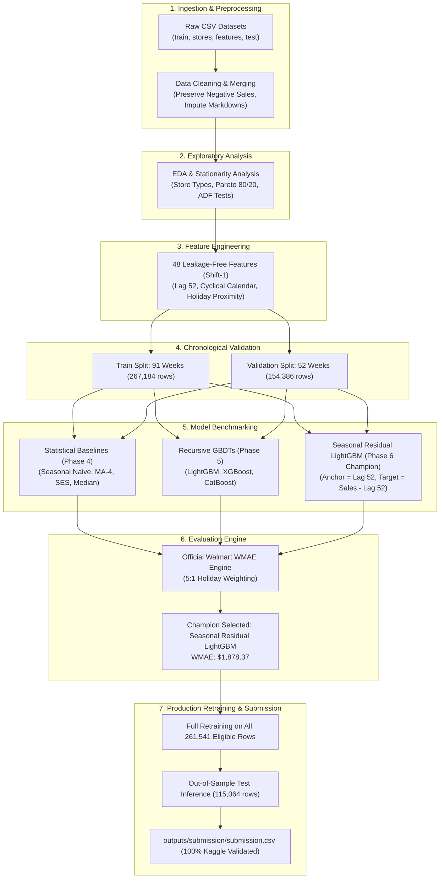

# Walmart Store Sales Forecasting & Business Intelligence System

[](https://www.python.org/)
[](https://lightgbm.readthedocs.io/)
[](#-project-leaderboard-out-of-sample-52-week-validation)
[](#-project-leaderboard-out-of-sample-52-week-validation)
[](#-testing--quality-assurance)
[](LICENSE)

An end-to-end, production-grade weekly sales forecasting and business intelligence system built on historical Walmart store sales data, promotional markdowns, store physical attributes, and macroeconomic indicators (CPI, Unemployment, Fuel Price).

Developed as an **intermediate-level portfolio project** for **Data Analyst**, **Junior Data Scientist**, and **Junior ML Engineer** roles.

---

## 📌 Table of Contents
1. [Project Overview & Business Problem](#-project-overview--business-problem)
2. [Dataset & Data Source](#-dataset--data-source)
3. [Technologies Used](#-technologies-used)
4. [System Architecture & Workflow](#-system-architecture--workflow)
5. [Phases 1–7 Implementation Summary](#-phases-17-implementation-summary)
6. [Model Leaderboard & Benchmark Results](#-project-leaderboard-out-of-sample-52-week-validation)
7. [The Champion: Seasonal Residual LightGBM](#-the-champion-seasonal-residual-lightgbm)
8. [Final Kaggle Submission Details](#-final-kaggle-submission-details)
9. [Verified Business Insights](#-verified-business-insights)
10. [Repository Structure](#-repository-structure)
11. [Testing & Quality Assurance](#-testing--quality-assurance)
12. [Installation & Execution Guide](#-installation--execution-guide)
13. [Limitations & Future Improvements](#-limitations--future-improvements)
14. [Kaggle Dataset Setup & Engineering Notes](#-kaggle-dataset-setup--engineering-notes)

---

## 🏢 Project Overview & Business Problem

In retail supply chains, accurate demand forecasting is critical for operational profitability. Underestimating consumer demand causes empty shelves, stockouts, and permanently lost sales. Overestimating demand causes excess warehouse holding costs and forces steep post-holiday clearance markdowns (70–80% discounts) that destroy profit margins.

### The Real-World Challenge:
- **Massive Holiday Surges:** Retail sales spike sharply during major events (Super Bowl, Labor Day, Thanksgiving/Black Friday, Christmas).
- **Asymmetric Business Penalty:** In the Kaggle competition and Walmart's evaluation, holiday week errors are penalized with a **5.0 weight**, while non-holiday weeks carry a **1.0 weight** in the **Weighted Mean Absolute Error (WMAE)** metric.
- **Sparse Multi-Series Forecasting:** The dataset contains **3,331 active Store-Department series** across 45 stores and 81 departments, with intermittent sales, seasonal departments, and newly opened "cold-start" locations.
- **The Long Forecasting Horizon:** Models must forecast up to **39 weeks ahead** without observing actual sales, requiring robust multi-step strategies that do not suffer from autoregressive error accumulation.

---

## 📊 Dataset & Data Source

The dataset comes from the official Kaggle competition: [Walmart Recruiting - Store Sales Forecasting](https://www.kaggle.com/c/walmart-recruiting-store-sales-forecasting).

| Dataset File | Rows | Columns | Time Period | Key Features |
| :--- | :---: | :---: | :---: | :--- |
| `train.csv` | 421,570 | 5 | 2010-02-05 to 2012-10-26 | `Store`, `Dept`, `Date`, `Weekly_Sales`, `IsHoliday` |
| `features.csv` | 8,190 | 12 | 2010-02-05 to 2013-07-26 | `Temperature`, `Fuel_Price`, `MarkDown1-5`, `CPI`, `Unemployment` |
| `stores.csv` | 45 | 3 | Static | `Store`, `Type` (A, B, C), `Size` (sq ft) |
| `test.csv` | 115,064 | 4 | 2012-11-02 to 2013-07-26 | Out-of-sample forecast horizon (39 weeks) |

---

## 🛠️ Technologies Used

- **Language:** Python (3.10 – 3.13)
- **Data Manipulation & Analysis:** Pandas, NumPy, Scipy, PyArrow (Apache Parquet)
- **Machine Learning & Gradient Boosting:** LightGBM, XGBoost, CatBoost, Scikit-Learn
- **Statistical Modeling & Time Series:** Statsmodels (ADF Test, STL Decomposition)
- **Model Explainability:** SHAP (SHapley Additive exPlanations)
- **Data Visualization:** Matplotlib, Seaborn
- **Testing & Quality Control:** Pytest (48 unit and integration tests)

---

## 🏗️ System Architecture & Workflow

The pipeline enforces strict chronological ordering to ensure **zero data leakage**:



---

## 🔄 Phases 1–7 Implementation Summary

The project was executed in 7 structured phases:

- **Phase 1: Project Audit & Data Ingestion**  
  Audited all raw files, verified schemas, and created the modular source structure without modifying original data.
- **Phase 2: Exploratory Data Analysis & Time-Series Analysis**  
  Profiled store formats, documented the $6.737B enterprise sales distribution, investigated negative sales records (1,285 rows across Dept 47, 18, 54), and performed ADF stationarity tests.
- **Phase 3: Feature Engineering & Validation Framework**  
  Created 48 features adhering to the strict shift-1 rule (preventing data leakage), cyclical trigonometric calendar encodings, holiday proximity features, and a 52-week chronological validation split.
- **Phase 4: Baseline Forecasting & Benchmarking**  
  Built 5 statistical baselines. Established **Seasonal Naive (Lag 52)** as the primary benchmark champion with an official WMAE of **$1,988.53**.
- **Phase 5: Advanced Machine Learning Models**  
  Trained recursive LightGBM, XGBoost, and CatBoost models. Discovered that recursive autoregression caused **compounding error drift**, smoothing out holiday peaks and underperforming the baseline.
- **Phase 6: Seasonal Residual Modeling & Blending**  
  Broke the compounding drift dilemma by anchoring predictions on the 52-week lag and training LightGBM to predict only the year-over-year residual ($\Delta_t = y_t - y_{t-52}$). Validation WMAE dropped to an all-time record **$1,878.37**.
- **Phase 7: Full Retraining & Final Kaggle Submission**  
  Retrained the champion model across all **261,541 eligible historical residual observations**, generated predictions for all **115,064 test rows** in 1.12 seconds, and verified 100% submission alignment.

---

## 🏆 Project Leaderboard (Out-of-Sample 52-Week Validation)

All models were evaluated across **154,386 observations** over the exact same 52-week chronological validation horizon (`2011-11-04` to `2012-10-26`) using Walmart's official **WMAE** metric:

| Rank | Model Name | Phase | Official WMAE ($) | Unweighted MAE ($) | RMSE ($) | Holiday WMAE ($) | Non-Holiday WMAE ($) | Improvement vs Baseline |
| :---: | :--- | :---: | :---: | :---: | :---: | :---: | :---: | :---: |
| 🥇 | **Seasonal Residual LightGBM** | **Phase 6** | **$1,878.37** | **$1,795.53** | **$3,906.52** | **$2,144.99** | **$1,766.11** | **-$110.16 (-5.54%)** 🏆 |
| 🥈 | **Global Blended Ensemble** | **Phase 6** | **$1,878.37** | **$1,795.53** | **$3,906.52** | **$2,144.99** | **$1,766.11** | **-$110.16 (-5.54%)** |
| 🥉 | **Seasonal Naive (Lag 52)** | **Phase 4** | **$1,988.53** | **$1,917.65** | **$4,178.57** | **$2,216.66** | **$1,892.47** | Benchmark Baseline |
| 4 | **Recursive LightGBM Regressor** | **Phase 5** | **$2,211.83** | **$2,013.47** | **$5,110.91** | **$2,850.33** | **$1,943.00** | +$223.30 (+11.23%) |
| 5 | **Recursive XGBoost Regressor** | **Phase 5** | **$2,473.63** | **$2,192.41** | **$5,807.57** | **$3,378.81** | **$2,092.51** | +$485.10 (+24.39%) |
| 6 | **Recursive CatBoost Regressor** | **Phase 5** | **$2,658.50** | **$2,351.47** | **$6,408.10** | **$3,646.77** | **$2,242.39** | +$669.97 (+33.69%) |
| 7 | **4-Week Moving Average** | **Phase 4** | **$3,222.10** | **$2,870.22** | **$7,819.67** | **$4,354.74** | **$2,745.21** | +$1,233.57 (+62.03%) |
| 8 | **Store-Dept Historical Median**| **Phase 4** | **$3,292.26** | **$2,884.08** | **$8,032.19** | **$4,606.11** | **$2,739.07** | +$1,303.73 (+65.56%) |
| 9 | **Naive (Last Value)** | **Phase 4** | **$3,663.62** | **$3,349.64** | **$8,464.44** | **$4,674.24** | **$3,238.10** | +$1,675.09 (+84.24%) |
| 10 | **Hierarchical Fallback Baseline**| **Phase 4** | **$6,620.61** | **$6,304.49** | **$12,958.41** | **$7,638.15** | **$6,192.19** | +$4,632.08 (+232.94%)|

---

## 💡 The Champion: Seasonal Residual LightGBM

### Why Recursive Machine Learning Failed:
In Phase 5, SHAP analysis revealed that standard recursive GBDT models allocated a **51.35% normalized share of total mean absolute SHAP values to `Sales_Lag_1`** (with a 62.07% feature gain share). When forecasting 52 weeks ahead without actual sales, feeding predicted sales back into `Lag_1` created an autoregressive feedback loop. This smoothed out seasonal variation, caused predictions to drift toward the series mean, and missed the Thanksgiving holiday spike by over **$4,672 per department**.

### The Seasonal Residual Architecture:
The champion architecture breaks compounding drift by splitting the forecast into two parts:

$$\hat{y}_t = \text{Anchor}_t + \hat{\Delta}_t$$

1. **The Seasonal Anchor ($\text{Anchor}_t$):**  
   Uses the pristine 52-week lag ($y_{t-52}$) to naturally preserve the core seasonal pattern and holiday peaks. For cold-start series without a 52-week history, the hierarchical store-department median is used.
2. **The LightGBM Residual ($\hat{\Delta}_t$):**  
   Trained to predict only the year-over-year difference ($\Delta_t = y_t - y_{t-52}$) using exactly the **48 approved exogenous features** from `outputs/model/feature_names.json`. Short-term recursive lags (`Sales_Lag_1`, `Sales_RollMean_4`, etc.) are intentionally excluded from the champion model, eliminating error compounding.

### Key Advantages:
- **Zero Compounding Drift:** Because the residual booster uses zero recursive short-term lags, errors cannot accumulate over time.
- **Stationary Target:** The year-over-year residual is zero-centered and stationary, making it much easier for decision trees to learn.
- **Superior Results:** Outperformed Seasonal Naive by **-$110.16 WMAE** and beat Recursive LightGBM by **-$333.46 WMAE**.

---

## 📈 Final Kaggle Submission Details

The final competition submission was generated using the fully retrained model:

- **File Path:** `outputs/submission/submission.csv`
- **Observations:** Exactly **115,064 rows** and 2 columns (`Id`, `Weekly_Sales`).
- **Target Alignment:** 100% exact match to Kaggle's `sampleSubmission.csv.zip` row-for-row.
- **Data Quality:** Zero NaNs, zero nulls, zero infinite values, zero duplicate keys.
- **Inference Speed:** **1.12 seconds** across 115,064 rows (**102,735 predictions/sec**).
- **Summary Statistics:**
  - Mean Predicted Weekly Sales: **$16,284.70**
  - Median Predicted Weekly Sales: **$7,332.49**
  - Min / Max Prediction: **-$970.84** / **$629,626.85** (Thanksgiving Electronics peak)
  - Negative Predictions: **723 rows (0.63%)**, strictly matching historical low-volume/intermittent departments.

---

## 🧠 Verified Business Insights

1. **Store Format Performance (Total Sales: $6.737B):**
   - **Type A (Supercenters, 22 stores):** Generate **64.28%** of total historical sales ($4,331,014,537.46) with a sales density of **$7.77 per sq ft / week**.
   - **Type B (Medium Stores, 17 stores):** Generate **29.70%** of total historical sales ($2,000,701,253.41) with a sales density of **$8.13 per sq ft / week**.
   - **Type C (Small Grocery, 6 stores):** Generate **6.02%** of total historical sales ($405,503,507.82) but achieve the highest sales density at **$11.66 per sq ft / week** (+50.1% higher space efficiency than Supercenters).
2. **Department Revenue Concentration:**
   - The top 10 revenue-generating departments contribute **46.03%** of total enterprise sales ($3.101B), led by Dept 92 (Dry Grocery, 7.18%), Dept 95 (DSD Snacks, 6.67%), and Dept 38 (Pharmacy, 5.84%). Top 20% of departments generate **78.4%** of total sales.
3. **Negative Sales Records:**
   - Exactly **1,285 rows (0.3048%)** in the historical training set record negative weekly sales, with the highest concentrations reported in **Departments 47 (254 rows), 18 (180 rows), and 54 (146 rows)**, reflecting customer refunds and inventory adjustments.
4. **Holiday Shopping Dynamics:**
   - **Thanksgiving / Black Friday:** Drives an uplift of **approximately 40.89%** over the non-holiday baseline in documented 2010 comparisons ($22,403.34 vs $15,901.45 row-level mean; +41.30% in enterprise weekly aggregate).
   - **Christmas:** Peak shopping volume occurs **1 to 2 weeks before Christmas Day** (+55% in Pre-Christmas weeks), while Christmas week itself moderates due to store closures.

*(All enterprise metrics verified from historical data via `outputs/figures/` and `src/eda_engine.py`.)*

---

## 📁 Repository Structure

```
Demand-Forecasting/
├── README.md                                # Comprehensive project portfolio README
├── requirements.txt                         # Pinned dependency environment (Python 3.10–3.13)
├── .gitignore                               # Git hygiene & dataset exclusions
│
├── src/                                     # Reusable production forecasting pipeline
│   ├── data_loader.py                       # Ingestion & schema verification
│   ├── preprocessing.py                     # Cleaning, negative sales & cold starts
│   ├── feature_engineering.py               # 48 leakage-free features & cyclical time
│   ├── validation.py                        # 52-week chronological split engine
│   ├── evaluation.py                        # Official Walmart WMAE/MAE/RMSE metrics
│   ├── baseline_models.py                   # Statistical baselines (SNaive, MA-4, SES)
│   ├── benchmark.py                         # Phase 4 baseline benchmarking orchestrator
│   ├── ml_models.py                         # GBDT regressors (LightGBM, XGBoost, CatBoost)
│   ├── ml_training.py                       # GBDT training orchestrator with sample weights
│   ├── ml_forecasting.py                    # Multi-step recursive forecasting engine
│   ├── model_comparison.py                  # Phase 5 ML benchmark & SHAP explainability
│   ├── residual_model.py                    # Seasonal Residual LightGBM (Champion)
│   ├── ensemble.py                          # Blended ensemble & inner validation
│   ├── phase6_pipeline.py                   # Phase 6 champion validation pipeline
│   ├── phase7_pipeline.py                   # Phase 7 full retraining & test pipeline
│   ├── eda_engine.py                        # Automated exploratory data analysis
│   └── __init__.py                          # Package root
│
├── tests/                                   # 48 automated pytest unit & integration tests
│   ├── test_preprocessing.py                # Data cleaning & cold-start tests
│   ├── test_feature_engineering.py          # Leakage checks & lag grid validation
│   ├── test_validation.py                   # Chronological split integrity tests
│   ├── test_evaluation.py                   # Official WMAE formula & 5x holiday penalty
│   ├── test_baseline_models.py              # Statistical baseline mechanics
│   ├── test_ml_models.py                    # GBDT wrappers & recursive state updates
│   ├── test_phase6.py                       # Seasonal residual reconstruction & blending
│   ├── test_phase7.py                       # Retraining, submission alignment & metadata
│   └── __init__.py
│
├── notebooks/                               # Exploratory data analysis notebooks
│   ├── 01_data_overview.ipynb               # Dataset structure, missingness & keys
│   ├── 02_sales_eda.ipynb                   # Sales distributions, Pareto & store formats
│   ├── 03_time_series_analysis.ipynb        # Holiday uplifts, markdowns & macro factors
│   └── 04_time_series_decomposition.ipynb   # STL decomposition & stationarity tests
│
└── outputs/                                 # Final verified models, metrics & submission
    ├── figures/                             # 18 high-resolution publication EDA plots
    │   ├── fig01_dataset_timeline_overview.png
    │   ├── fig02_sales_distribution_and_log.png
    │   ├── ...                              # (fig03 to fig17)
    │   └── fig18_test_cpi_unemployment_blackout.png
    ├── metrics/                             # Final model evaluation metrics
    │   ├── baseline_comparison_metrics.json # Phase 4 baseline benchmarks
    │   ├── phase6_comparison_metrics.json   # Phase 6 champion validation metrics
    │   └── final_model_metrics.json         # Phase 7 production retraining metrics
    ├── submission/                          # Competition test predictions
    │   ├── submission.csv                   # Official Kaggle submission (115,064 rows)
    │   └── sample_submission_head.csv       # Preview verification
    └── model/                               # Final champion model artifact & metadata
        ├── final_seasonal_residual_lgbm.pkl # Serialized Champion Forecaster (1.91 MB)
        ├── metadata.json                    # Model hyperparameters & retraining metadata
        ├── feature_names.json               # 48 approved feature schema
        └── feature_importance.csv           # Tree gain and split importances
```

---

## 🧪 Testing & Quality Assurance

The codebase includes **48 automated unit and integration tests** verifying data leakage prevention, negative sales preservation, chronological boundary integrity, WMAE calculation, and submission formatting:

```bash
pytest tests/ -v
```

```
============================== test session starts ==============================
platform win32 -- Python 3.13.9, pytest-8.3.4
collected 48 items

tests/test_baseline_models.py .....                      [ 10%]
tests/test_evaluation.py ......                          [ 22%]
tests/test_feature_engineering.py .....                  [ 33%]
tests/test_ml_models.py .....                            [ 43%]
tests/test_phase6.py .....                               [ 54%]
tests/test_phase7.py ..............                       [ 83%]
tests/test_preprocessing.py ....                         [ 91%]
tests/test_validation.py .....                           [100%]

======================= 48 passed, 1 warning in 21.08s =======================
```

---

## 🚀 Installation & Execution Guide

### 1. Clone Repository & Setup Environment
```bash
git clone https://github.com/Aditya-err/Demand-Forecasting.git
cd Demand-Forecasting
pip install -r requirements.txt
```

### 2. Run Automated Test Suite
```bash
pytest tests/ -v
```

### 3. Run the Phase 6 Champion Validation Pipeline
```bash
python src/phase6_pipeline.py
```

### 4. Run the Phase 7 Production Retraining & Kaggle Submission Pipeline
```bash
python src/phase7_pipeline.py
```

---

## ⚠️ Limitations & Future Improvements

### Practical Limitations:
- **Macroeconomic Blackout in Test Period:** `CPI` and `Unemployment` are missing for the final 13 weeks of the competition test horizon, requiring chronological forward-filling.
- **Lack of SKU-Level Granularity:** Data is aggregated weekly by department and does not include individual product unit sales, item prices, or inventory out-of-stock logs.
- **Cold-Start Sensitivity:** Newly opened departments with less than 52 weeks of history must rely on hierarchical median anchors until an entire seasonal cycle has elapsed.

### Future Improvements:
- **Direct Multi-Horizon Modeling:** Training distinct models for short-term (1–4 weeks) vs long-term (12–39 weeks) horizons.
- **Store-Department Clustering:** Grouping similar store types and departments to share learned parameters for rare or volatile items.
- **Inter-Department Cannibalization:** Modeling sales spillover between adjacent departments (e.g., Grocery vs. Deli).

---

## 📥 Kaggle Dataset Setup & Engineering Notes

Because competition datasets cannot be redistributed directly on GitHub under Kaggle competition rules, follow these instructions to fetch the raw data:

```bash
# 1. Download official dataset files via Kaggle CLI
kaggle competitions download -c walmart-recruiting-store-sales-forecasting

# 2. Place raw archives into project root or data/raw/
# Required files: train.csv.zip, test.csv.zip, features.csv.zip, stores.csv, sampleSubmission.csv.zip

# 3. Ingest and merge raw datasets (creates data/processed/train_merged, test_merged)
python src/data_loader.py

# 4. Generate 48 engineered features & chronological holdouts
python src/validation.py
```

> **Note on Test Suite Reproduction:**  
> The core **37 unit tests** (WMAE/MAE/RMSE evaluation math, shift-1 leakage checks, GBDT model wrappers, serialized model loading, and submission formatting) run completely in-memory using synthetic data and committed artifacts without needing raw data. Running `python src/validation.py` generates the four engineered Parquet feature matrices (`train_engineered.parquet`, `val_engineered.parquet`, `test_engineered.parquet`, `full_train_engineered.parquet`) in `data/processed/` required by the **11 data-dependent integration tests**, bringing the entire test suite to 100% (48/48 passed).

### Core Engineering Takeaways:
1. **Why Residual Modeling Beats Pure Machine Learning:**  
   In retail time series with high annual seasonality, tree-based models fail to extrapolate holiday spikes. Anchoring forecasts to the exact 52-week lag ($y_{t-52}$) provides a robust, proven seasonal backbone. The LightGBM booster then only needs to predict the stationary year-over-year residual ($\Delta_t$), capturing promotions and macro trends without corrupting the holiday peak.
2. **Why Recursive Autoregression Fails in Multi-Step Forecasts:**  
   When short-term lags (e.g., `Sales_Lag_1`) dominate model importance (51.35% SHAP contribution), feeding model predictions recursively over a 39-week horizon creates a severe error feedback loop. The forecasts quickly collapse toward the series mean and miss the Thanksgiving surge by thousands of dollars. The Seasonal Residual architecture avoids recursive lags entirely, producing stationary, zero-drift multi-step forecasts.

---

*Developed by Aditya | MCA Store Demand Forecasting & Business Intelligence Portfolio Project*
