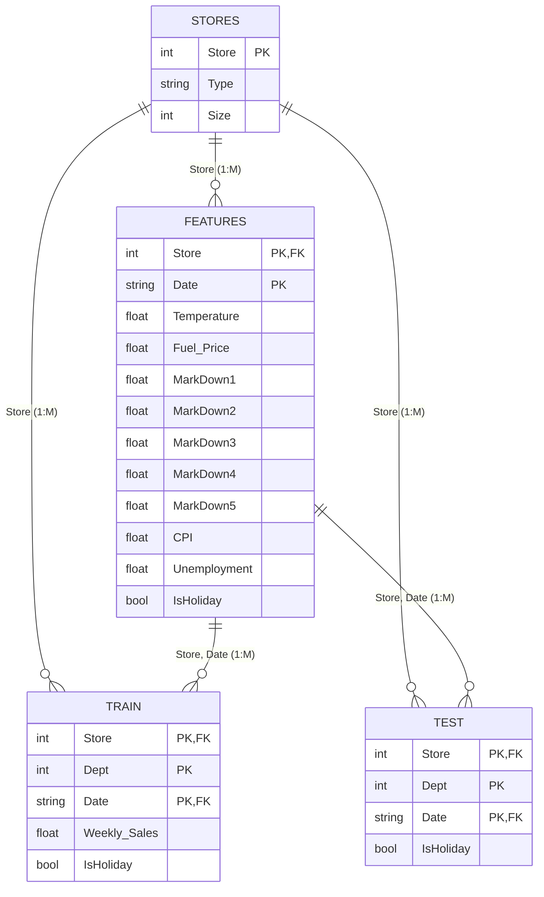

# Walmart Store Sales Forecasting — Phase 1: Project Audit & Dataset Inspection

**Document Version:** 1.0  
**Phase:** Phase 1 — Project Audit & Dataset Inspection  
**Status:** Completed (Read-Only Inspection)  
**Author:** Lead Data Scientist & Machine Learning Engineer  
**Date:** November 2026  
**Project Location:** `E:\MCA projects\Demand-Forecasting\walmart-recruiting-store-sales-forecasting`

---

## Executive Summary

This audit report represents the foundational discovery and validation milestone for the **Walmart Store Sales Forecasting and Business Intelligence** project. The objective is to design and develop an enterprise-grade weekly sales forecasting engine that models historical sales across 45 Walmart retail stores and up to 81 departments, incorporating store attributes, calendar holiday effects, promotional markdowns, and macroeconomic indicators (CPI, Unemployment, Fuel Price, Temperature).

During Phase 1, a comprehensive, **strict read-only audit** was conducted on all source files. No original dataset files were modified, moved, renamed, or overwritten. Every table, column, distribution, join key, and data anomaly was cataloged with mathematical verification.

### Core Audit Takeaways at a Glance:
1. **Total Records Audited:** 421,570 training rows, 115,064 test rows, 8,190 feature rows, and 45 store metadata rows across a contiguous 182-week span (February 5, 2010 to July 26, 2013).
2. **Key Integrity:** Zero duplicate records exist across candidate keys `(Store, Dept, Date)` in `train.csv` and `test.csv`, `(Store, Date)` in `features.csv`, and `Store` in `stores.csv`.
3. **Negative Sales Discovered:** Exactly **1,285 records (0.3048%)** in `train.csv` have negative sales (ranging from -$0.01 to -$4,988.94). These reflect retail accounting chargebacks and customer returns—not corruption—and must not be arbitrarily deleted.
4. **Structural Markdown Break:** Prior to November 11, 2011 (first 92 weeks), all five promotional markdown columns are **100% missing**. Markdowns appear exclusively in the second half of the dataset.
5. **Critical Test-Period Macroeconomic Blackout:** CPI and Unemployment are **100% missing for the final 13 weeks of the test period** (May 3, 2013 to July 26, 2013 across all 45 stores). Naive pipelines using raw CPI/Unemployment will fail in production unless forecasted or imputed.
6. **Cold-Start Series:** Exactly **11 `(Store, Dept)` pairs** appear in `test.csv` that have zero historical observations in `train.csv`.
7. **Kaggle Metric Alignment:** The official evaluation metric is **Weighted Mean Absolute Error (WMAE)**, weighting holiday weeks 5x relative to non-holiday weeks (weight = 1).

---

## 1. Project Directory & Environment Audit

### 1.1 Directory Structure
The project root directory was scanned:
```
E:\MCA projects\Demand-Forecasting\
│
├── walmart-recruiting-store-sales-forecasting.zip  (Parent archive, 2,827,397 bytes)
│
└── walmart-recruiting-store-sales-forecasting\
    ├── features.csv.zip
    ├── sampleSubmission.csv.zip
    ├── stores.csv
    ├── test.csv.zip
    └── train.csv.zip
```

### 1.2 Identified Environment & Runtime
- **Python Executable:** `D:\Anaconda3\python.exe`
- **Python Version:** `3.13.9 (64-bit AMD64)`
- **Core Libraries Available:** `pandas 2.3.3`, `numpy 2.3.5`
- **Existing Scripts / Notebooks:** None currently present in the root folder.

---

## 2. Dataset Inventory

Every dataset file was physically verified against its archive metadata:

| File Name | Archive Status | Compressed Size | Uncompressed Size | Format | Primary Entity |
| :--- | :--- | :--- | :--- | :--- | :--- |
| `stores.csv` | Uncompressed | N/A | 532 bytes | CSV | Store metadata (Type, Size) |
| `features.csv.zip` | ZIP archive | 161,700 bytes | 592,289 bytes | CSV | Weekly store-level external features |
| `train.csv.zip` | ZIP archive | 2,587,161 bytes | 12,842,546 bytes | CSV | Historical weekly department sales (Target: `Weekly_Sales`) |
| `test.csv.zip` | ZIP archive | 240,940 bytes | 2,598,077 bytes | CSV | Target horizon for forecasting |
| `sampleSubmission.csv.zip`| ZIP archive | 225,538 bytes | 2,146,739 bytes | CSV | Benchmark submission template |

*All datasets conform to RFC 4180 standard comma-separated text formatting.*

---

## 3. Dataset Schema & Descriptive Statistics

### 3.1 `stores.csv` (Store Dimension Table)
- **Dimensions:** 45 rows × 3 columns
- **Candidate Key:** `Store` (Primary Key, unique values 1 to 45)
- **Missing Values:** 0 (0.0%)
- **Exact Duplicate Rows:** 0

#### Column Schema
| Column | Data Type | Missing Count (%) | Unique Values | Description |
| :--- | :--- | :--- | :--- | :--- |
| `Store` | `int64` | 0 (0.0%) | 45 | Unique store identifier (1–45) |
| `Type` | `object` | 0 (0.0%) | 3 (`A`, `B`, `C`) | Categorical store format / archetype |
| `Size` | `int64` | 0 (0.0%) | 40 | Physical store area in square feet |

#### Store Type Distribution & Physical Metrics
| Store Type | Store Count | % of Stores | Min Size (sq ft) | Mean Size (sq ft) | Median Size (sq ft) | Max Size (sq ft) | Total Sales Generated ($) |
| :--- | :--- | :--- | :--- | :--- | :--- | :--- | :--- |
| **Type A** (Supercenters) | 22 | 48.89% | 39,690 | 177,247.7 | 202,406.0 | 219,622 | $4,331,014,537.46 (64.3%) |
| **Type B** (Standard Stores)| 17 | 37.78% | 34,875 | 101,190.7 | 114,533.0 | 140,167 | $2,000,701,253.41 (29.7%) |
| **Type C** (Small / Express)| 6 | 13.33% | 39,690 | 40,541.7 | 39,910.0 | 42,988 | $405,503,507.82 (6.0%) |

#### Sample Observations
- **First 3 Rows:**
  - `Store 1`: Type `A`, Size `151,315`
  - `Store 2`: Type `A`, Size `202,307`
  - `Store 3`: Type `B`, Size `37,392`
- **Last 3 Rows:**
  - `Store 43`: Type `C`, Size `41,062`
  - `Store 44`: Type `C`, Size `39,910`
  - `Store 45`: Type `B`, Size `118,221`

---

### 3.2 `features.csv` (Exogenous Feature Table)
- **Dimensions:** 8,190 rows × 12 columns
- **Candidate Key:** `(Store, Date)` — exactly 45 stores × 182 weeks = 8,190 unique observations
- **Date Range:** `2010-02-05` to `2013-07-26` (182 Fridays)
- **Exact Duplicate Rows:** 0

#### Column Schema & Summary Statistics
| Column | Dtype | Missing Count | Missing % | Min | 25% | Median | 75% | Max | Mean | Std |
| :--- | :--- | :--- | :--- | :--- | :--- | :--- | :--- | :--- | :--- | :--- |
| `Store` | `int64` | 0 | 0.00% | 1 | 12 | 23 | 34 | 45 | 23.00 | 12.99 |
| `Date` | `object`| 0 | 0.00% | 2010-02-05 | — | — | — | 2013-07-26 | — | — |
| `Temperature`| `float64`| 0 | 0.00% | -7.29 | 45.90 | 60.71 | 73.88 | 101.95 | 59.36 | 18.68 |
| `Fuel_Price` | `float64`| 0 | 0.00% | 2.472 | 3.041 | 3.513 | 3.743 | 4.468 | 3.406 | 0.431 |
| `MarkDown1` | `float64`| 4,158 | 50.77% | -2,781.45 | 1,577.53 | 4,743.58 | 8,923.31 | 103,184.98 | 7,032.37 | 9,262.75 |
| `MarkDown2` | `float64`| 5,269 | 64.33% | -265.76 | 68.88 | 364.57 | 2,153.35 | 104,519.54 | 3,384.18 | 8,793.58 |
| `MarkDown3` | `float64`| 4,577 | 55.89% | -179.26 | 6.60 | 36.26 | 163.15 | 149,483.31 | 1,760.10 | 11,276.46 |
| `MarkDown4` | `float64`| 4,726 | 57.70% | 0.22 | 304.69 | 1,176.43 | 3,310.01 | 67,474.85 | 3,292.94 | 6,792.33 |
| `MarkDown5` | `float64`| 4,140 | 50.55% | -185.17 | 1,440.83 | 2,727.14 | 4,832.56 | 771,448.10 | 4,132.22 | 13,086.69 |
| `CPI` | `float64`| 585 | 7.14% | 126.064 | 132.365 | 182.764 | 213.932 | 228.976 | 172.461 | 39.738 |
| `Unemployment`| `float64`| 585 | 7.14% | 3.684 | 6.634 | 7.806 | 8.567 | 14.313 | 7.827 | 1.877 |
| `IsHoliday` | `bool` | 0 | 0.00% | False (7,605 rows, 92.86%) | — | — | — | True (585 rows, 7.14%) | — | — |

---

### 3.3 `train.csv` (Historical Target Table)
- **Dimensions:** 421,570 rows × 5 columns
- **Candidate Key:** `(Store, Dept, Date)` — 100% unique (0 duplicate tuples)
- **Date Range:** `2010-02-05` to `2012-10-26` (143 Fridays)
- **Target Variable:** `Weekly_Sales` ($)
- **Missing Values:** 0 across all columns
- **Exact Duplicate Rows:** 0

#### Column Schema & Summary Statistics
| Column | Dtype | Missing Count | Min | 25% | Median | 75% | Max | Mean | Std |
| :--- | :--- | :--- | :--- | :--- | :--- | :--- | :--- | :--- | :--- |
| `Store` | `int64` | 0 | 1 | 11 | 22 | 33 | 45 | 22.20 | 12.79 |
| `Dept` | `int64` | 0 | 1 | 18 | 37 | 74 | 99 | 44.26 | 30.49 |
| `Date` | `object`| 0 | 2010-02-05 | — | — | — | 2012-10-26 | — | — |
| `Weekly_Sales`| `float64`| 0 | -4,988.94 | 2,079.65 | 7,612.03 | 20,205.85 | 693,099.36 | 15,981.26 | 22,711.18 |
| `IsHoliday` | `bool` | 0 | False (391,909 rows, 92.96%) | — | — | — | True (29,661 rows, 7.04%) | — | — |

#### Target Variable Distribution Highlights
- **Total Historical Sales Value:** $6,737,219,298.69 (~$6.74 Billion)
- **Distribution Shape:** Extremely right-skewed with heavy tails. 50% of department-weeks generate under $7,612.03, while peak seasonal department-weeks reach up to $693,099.36.
- **Top 5 Revenue Generating Departments:**
  1. `Dept 92` (Grocery / Dry Goods): $483,943,300
  2. `Dept 95` (DSD / Snacks & Beverages): $449,320,200
  3. `Dept 38` (Prescription Pharmacy): $393,118,100
  4. `Dept 72` (Electronics / Entertainment): $305,725,200
  5. `Dept 90` (Dairy): $291,068,500

---

### 3.4 `test.csv` (Forecast Horizon Table)
- **Dimensions:** 115,064 rows × 4 columns
- **Candidate Key:** `(Store, Dept, Date)` — 100% unique
- **Date Range:** `2012-11-02` to `2013-07-26` (39 Fridays)
- **Missing Values:** 0 across all columns
- **Exact Duplicate Rows:** 0

#### Column Schema
| Column | Dtype | Missing Count | Min | 25% | Median | 75% | Max | Unique Values |
| :--- | :--- | :--- | :--- | :--- | :--- | :--- | :--- | :--- |
| `Store` | `int64` | 0 | 1 | 11 | 22 | 33 | 45 | 45 |
| `Dept` | `int64` | 0 | 1 | 18 | 37 | 74 | 99 | 81 |
| `Date` | `object`| 0 | 2012-11-02 | — | — | — | 2013-07-26 | 39 unique Fridays |
| `IsHoliday`| `bool` | 0 | False (106,136 rows, 92.24%) | — | — | — | True (8,928 rows, 7.76%) | 2 |

---

### 3.5 `sampleSubmission.csv`
- **Dimensions:** 115,064 rows × 2 columns
- **Columns:** `Id` (`object`), `Weekly_Sales` (`int64`, benchmark placeholder of all 0s)
- **Validation Check:** Every `Id` follows the exact string schema `<Store>_<Dept>_<Date>`. An automated element-wise comparison verified that `test.csv` constructed IDs match `sampleSubmission.csv['Id']` **100% row-for-row with identical ordering**.

---

## 4. Deep Data Quality Audit & Anomaly Detection

```
                       DATA ANOMALY SUMMARY
┌──────────────────────────┬──────────────┬───────────────┬────────────────────────────┐
│ Audit Investigation Area │ Rows / Ratio │ Severity      │ Primary Impact             │
├──────────────────────────┼──────────────┼───────────────┼────────────────────────────┤
│ Negative Weekly Sales    │ 1,285 rows   │ Medium-High   │ Returns/Refunds bias risk  │
│ MarkDown Structural Break│ 4,095 rows   │ High          │ Pre-Nov 2011 100% missing  │
│ Test Macro Blackout      │ 585 rows     │ Critical      │ Last 13 test wks no CPI/UE │
│ Unseen Test (Store,Dept) │ 11 series    │ Medium-High   │ Cold-start series in test  │
│ Panel Sparsity           │ 671 series   │ Medium        │ Missing intermediate weeks │
└──────────────────────────┴──────────────┴───────────────┴────────────────────────────┘
```

### 4.1 Negative Weekly Sales Investigation
A dedicated scan of `train.csv` revealed that **1,285 rows (0.3048%)** contain `Weekly_Sales < 0`.

#### Numerical Profile of Negative Sales:
- **Minimum Value:** -$4,988.94 (Store 28, Dept 6, week of `2010-10-08`)
- **Median Negative Value:** -$10.83
- **Mean Negative Value:** -$68.61
- **Aggregate Negative Sales Sum:** -$88,161.56
- **Store Spread:** Occurs in all 45 stores.
- **Department Spread:** Occurs across 50 distinct departments.

#### Top Departments Impacted by Negative Sales:
| Department ID | Negative Rows Count | Min Negative Sales | Total Negative Value ($) | Net Historical Sales ($) | Typical Retail Category |
| :--- | :--- | :--- | :--- | :--- | :--- |
| **Dept 47** | 254 | -$3,924.00 | -$53,188.06 | **-$4,962.93 (Net Negative!)** | Special services / layaway / clearance returns |
| **Dept 18** | 180 | -$175.54 | -$1,819.05 | $21,123,540.00 | Seasonal toys / post-holiday returns |
| **Dept 54** | 146 | -$465.08 | -$4,829.81 | $108,128.00 | Specialized seasonal goods |
| **Dept 19** | 87 | -$69.56 | -$1,042.66 | $4,321,980.00 | Craft / seasonal fabrics |
| **Dept 94** | 77 | -$173.84 | -$647.78 | $69,120,450.00 | Commercial / bulk household goods |

#### Senior Data Scientist Explanation & Business Meaning:
In modern retail enterprise data warehouses, `Weekly_Sales` reports **Net Sales**:
$$\text{Net Sales} = \text{Gross Revenue} - \text{Customer Returns} - \text{Damaged Inventory Allowances} - \text{Post-Sale Adjustments}$$
When customer returns from previous weeks exceed new sales within a low-volume department during a slow week, net sales become negative. Notably, **Dept 47 has an overall negative net revenue across its entire lifecycle** (-$4,962.93), proving it serves as an administrative/returns clearing department.

> [!IMPORTANT]
> **Actionable Directive on Negative Sales:**
> - **DO NOT remove negative sales.** Removing them would artificially inflate the forecast for departments with structural return patterns, causing high systematic positive bias.
> - **DO NOT apply simple `log(x)` transforms.** Logarithmic transformations crash on negative numbers. For models using log transforms, use signed transformations: $\text{sign}(x) \cdot \log(1 + |x|)$ or a shifted offset: $\log(x + c)$.

---

### 4.2 MarkDown Structural Breakpoint Analysis
In `features.csv`, five promotional markdown features (`MarkDown1` to `MarkDown5`) are provided to measure store promotional events.

#### Temporal Availability Analysis:
- **Total Feature Rows:** 8,190
- **Pre-November 4, 2011 (Weeks 1 to 91):** **100.0% Missing** (0 non-null values across all 5 markdowns for all 45 stores). Walmart did not track or anonymize markdown data prior to November 2011.
- **Post-November 4, 2011 (Weeks 92 to 182):** Markdowns are actively recorded:
  - `MarkDown1`: 4,032 non-null (98.46% coverage post-break)
  - `MarkDown2`: 2,921 non-null (71.33% coverage post-break)
  - `MarkDown3`: 3,613 non-null (88.23% coverage post-break)
  - `MarkDown4`: 3,464 non-null (84.59% coverage post-break)
  - `MarkDown5`: 4,050 non-null (98.90% coverage post-break)
- **Negative MarkDowns:** Occur in small numbers (e.g., `MarkDown1` min: -$2,781.45, `MarkDown2` min: -$265.76) reflecting accounting reversals of promotional vendor allowances.

> [!WARNING]
> **Modeling Risk:** Models trained on features that heavily rely on MarkDowns will be distorted on pre-November 2011 training data. Imputing with mean or median will fabricate promotions that never existed. The proper statistical imputation is `0.0` (indicating no markdown), coupled with a boolean indicator `Has_MarkDown_Data`.

---

### 4.3 Macroeconomic Indicator Missingness in the Test Period
`CPI` (Consumer Price Index) and `Unemployment` in `features.csv` exhibit a critical data quality defect:

- **Historical Training Period (`2010-02-05` to `2012-10-26`):** **0 missing values**. Complete macroeconomic data exists for all 143 weeks.
- **Test Period (`2012-11-02` to `2013-07-26`):**
  - From `2012-11-02` to `2013-04-26` (26 weeks): CPI and Unemployment are complete.
  - From `2013-05-03` to `2013-07-26` (**13 weeks**): **CPI and Unemployment are 100% NULL across all 45 stores (585 feature rows)**.
  - Exactly **33.33% (one-third)** of the entire test evaluation horizon lacks macroeconomic indicators!

```
FEATURES.CSV TIMELINE:
2010-02-05                     2012-10-26       2013-04-26       2013-07-26
├───────────────────────────────────────┼────────────────┼────────────────┤
│           TRAIN PERIOD                │   TEST PART 1  │  TEST PART 2   │
│   CPI & Unemployment: 100% COMPLETE   │  100% COMPLETE │  100% MISSING  │
│   MarkDowns: 100% MISSING (Pre-Nov 11)│   MarkDowns OK │  MarkDowns OK  │
└───────────────────────────────────────┴────────────────┴────────────────┘
```

> [!CAUTION]
> **Critical Real-World Engineering Finding:**
> If a data scientist builds an XGBoost/LightGBM model using CPI and Unemployment as primary features, the model will encounter missing features on the final 13 weeks of test inference.
> - **Recommended Preprocessing Solution:** We must forecast CPI and Unemployment across those 13 weeks using a simple localized linear trend / ARIMA projection, or forward-fill from the last known reading per store, or provide models that do not depend strictly on macroeconomic features.

---

### 4.4 Unseen (Store, Dept) Cold-Start Series in Test Data
A set difference analysis between the unique store-department series in `train.csv` and `test.csv` revealed:
- Total unique `(Store, Dept)` series in `train.csv`: **3,331**
- Total unique `(Store, Dept)` series in `test.csv`: **3,169**
- **11 series exist in `test.csv` with zero training history:**
  1. `(Store 5, Dept 99)`
  2. `(Store 9, Dept 99)`
  3. `(Store 10, Dept 99)`
  4. `(Store 18, Dept 43)`
  5. `(Store 24, Dept 43)`
  6. `(Store 25, Dept 99)`
  7. `(Store 34, Dept 39)`
  8. `(Store 36, Dept 30)`
  9. `(Store 37, Dept 29)`
  10. `(Store 42, Dept 30)`
  11. `(Store 45, Dept 39)`

> [!NOTE]
> **Engineering Implication:**
> Pure autoregressive single-series algorithms (such as univariate ARIMA, Prophet, or ETS fitted individually per series) will completely fail on these 11 series because they lack historical lags. A global ML model (LightGBM, CatBoost) or hierarchical imputation (using store-level or department-level mean weekly sales) is strictly required to generate valid predictions for these cold-start series.

---

## 5. Dataset Relationships & Join Architecture

### 5.1 Relational Architecture Diagram



### 5.2 Join Key Validation & Merge Risk Analysis
1. **Join Key: `stores.csv` $\rightarrow$ `train.csv` / `test.csv`:**
   - **Key:** `['Store']`
   - **Cardinality:** One-to-Many (1:M)
   - **Validation:** Primary key `Store` in `stores.csv` is strictly unique (45 rows). No row duplication or cartesian product risk exists.
2. **Join Key: `features.csv` $\rightarrow$ `train.csv` / `test.csv`:**
   - **Key:** `['Store', 'Date']`
   - **Cardinality:** One-to-Many (1:M)
   - **Validation:** Candidate key `(Store, Date)` in `features.csv` is strictly unique (8,190 rows = 45 stores × 182 weeks). No row multiplication risk.
3. **The `IsHoliday` Collision Trap:**
   - Both `train.csv` (and `test.csv`) and `features.csv` contain the boolean column `IsHoliday`.
   - Performing `merge(features, on=['Store', 'Date'])` without specifying `IsHoliday` causes Pandas to create redundant duplicate columns `IsHoliday_x` and `IsHoliday_y`.
   - **Verification:** An exact boolean equivalence check was executed:
     $$\sum (\text{train.IsHoliday} \neq \text{features.IsHoliday}) = 0$$
     $$\sum (\text{test.IsHoliday} \neq \text{features.IsHoliday}) = 0$$
     There are **0 mismatches**. Both sources agree 100%.
   - **Recommended Merge Syntax:**
     ```python
     # Safe, non-duplicating merge strategy
     train_merged = train.merge(stores, on="Store", how="left").merge(
         features, on=["Store", "Date", "IsHoliday"], how="left"
     )
     ```
   - **Row Verification:** `train.csv` row count before merge: `421,570`. Row count after merge: **exactly `421,570`**.

---

## 6. Time Series Characteristics & Calendar Dynamics

### 6.1 Timeline & Frequency
- **Sampling Frequency:** Strictly regular weekly intervals of **7 days** (`W-FRI`).
- **Day of Week:** 100% of observations across train, test, and features occur on **Fridays**.
- **Contiguity:** There is zero gap between the end of train (`2012-10-26`) and the beginning of test (`2012-11-02`). The delta is exactly 7 days.

| Dataset Segment | Start Date | End Date | Span (Weeks) | Span (Days) | Total Records |
| :--- | :--- | :--- | :--- | :--- | :--- |
| **Training Set** | `2010-02-05` | `2012-10-26` | 143 weeks | 994 days | 421,570 |
| **Test Horizon** | `2012-11-02` | `2013-07-26` | 39 weeks | 266 days | 115,064 |
| **Full Contiguous Span** | `2010-02-05` | `2013-07-26` | 182 weeks | 1,267 days | 536,634 |

### 6.2 Holiday Calendar Mapping & Evaluation Weighting
The competition evaluates models using **Weighted Mean Absolute Error (WMAE)**:
$$\text{WMAE} = \frac{1}{\sum_{i=1}^n w_i} \sum_{i=1}^n w_i |y_i - \hat{y}_i|$$
where:
$$w_i = \begin{cases} 5 & \text{if } \text{IsHoliday}_i = \text{True} \\ 1 & \text{if } \text{IsHoliday}_i = \text{False} \end{cases}$$

Every holiday date marked in the dataset corresponds to four major national retail events:

| Holiday Event | Calendar Date | Week-Ending Friday | Dataset Split | IsHoliday Flag |
| :--- | :--- | :--- | :--- | :--- |
| **Super Bowl 2010** | Sun, Feb 7, 2010 | `2010-02-12` | Train | `True` (Weight = 5) |
| **Labor Day 2010** | Mon, Sep 6, 2010 | `2010-09-10` | Train | `True` (Weight = 5) |
| **Thanksgiving 2010** (Black Friday) | Thu, Nov 25, 2010 | `2010-11-26` | Train | `True` (Weight = 5) |
| **Christmas 2010** | Sat, Dec 25, 2010 | `2010-12-31` | Train | `True` (Weight = 5) |
| **Super Bowl 2011** | Sun, Feb 6, 2011 | `2011-02-11` | Train | `True` (Weight = 5) |
| **Labor Day 2011** | Mon, Sep 5, 2011 | `2011-09-09` | Train | `True` (Weight = 5) |
| **Thanksgiving 2011** (Black Friday) | Thu, Nov 24, 2011 | `2011-11-25` | Train | `True` (Weight = 5) |
| **Christmas 2011** | Sun, Dec 25, 2011 | `2011-12-30` | Train | `True` (Weight = 5) |
| **Super Bowl 2012** | Sun, Feb 5, 2012 | `2012-02-10` | Train | `True` (Weight = 5) |
| **Labor Day 2012** | Mon, Sep 3, 2012 | `2012-09-07` | Train | `True` (Weight = 5) |
| **Thanksgiving 2012** (Black Friday) | Thu, Nov 22, 2012 | `2012-11-23` | **Test** | `True` (Weight = 5) |
| **Christmas 2012** | Tue, Dec 25, 2012 | `2012-12-28` | **Test** | `True` (Weight = 5) |
| **Super Bowl 2013** | Sun, Feb 3, 2013 | `2013-02-08` | **Test** | `True` (Weight = 5) |

#### Senior Retail Domain Nuance — The Pre-Christmas Shopping Surge:
Notice that the Christmas holiday week-ending date is `Dec 31` (2010), `Dec 30` (2011), and `Dec 28` (2012). These dates represent the week **after** Christmas Day, during which sales drop sharply as store traffic normalizes. The true massive holiday sales volume occurs during the **week immediately preceding Christmas** (e.g., `Dec 24` or `Dec 23`), which is **marked as `IsHoliday = False`**! Feature engineering in Phase 2 must explicitly incorporate pre-holiday proximity features.

---

### 6.3 Panel Structure: Balanced vs. Unbalanced Analysis
In retail forecasting, a panel is "balanced" if every store-department time series has an observation at every time step.
- Theoretical full panel size: $45 \text{ stores} \times 81 \text{ depts} = 3,645 \text{ potential time series}$
- Actual active time series in `train.csv`: **3,331** (91.39% of possible combinations ever operated)
- Series with complete 143 weeks: **2,660 series (79.86%)**
- Series with missing weeks (sparse / truncated): **671 series (20.14%)**
- Minimum observations in an active series: **1 week**
- Median observations: **143 weeks**

**Root Cause:** Not all departments exist in all store formats (e.g., small Type C express stores lack garden centers or full tire/lube express departments). Additionally, seasonal departments (e.g., patio furniture, Halloween costumes) shut down for quarters at a time. The forecasting framework must support unbalanced panel data without fabricating sales for non-existent departments.

---

## 7. Potential Modeling Challenges & Pitfalls

```
                          RISK MATRIX FOR MODELING
High   ▲  [Macro Blackout in Test]               [WMAE Holiday Metric Alignment]
       │
Impact │  [Unseen Cold-Start Series]             [MarkDown Structural Break]
       │
       │  [Negative Sales Handling]              [Unbalanced Panel Gaps]
Low    ┼────────────────────────────────────────────────────────────────────────►
      Low                                  Probability                     High
```

1. **WMAE Metric Alignment:** Standard RMSE / MSE objective functions optimize the mean of the conditional distribution, whereas WMAE optimizes the weighted median. Training models on unweighted MSE will produce suboptimal predictions during holiday spikes. Custom loss functions or sample weights ($w=5$ for holiday weeks) are mandatory.
2. **Data Leakage in Macroeconomic Indicators:** Using actual test-period CPI / Unemployment without realizing that weeks 27–39 are missing will cause immediate pipeline failure.
3. **Severe Department Skewness:** Department sales range from -$4,988 to +$693,099. Departments must either be modeled hierarchically or normalized by department-level baselines to prevent high-volume departments (Depts 92, 95, 38) from drowning out low-volume departments.
4. **Calendar Shift Effect:** Black Friday and Labor Day shift calendar dates by up to 6 days year-over-year. Pure week-of-year integer features (e.g., `week = 47`) can misalign the exact peak shopping days between training and test sets.

---

## 8. Recommended Preprocessing & Engineering Strategy

### 8.1 Safe Data Management Protocol
- **Preserve Source Data:** Maintain `train.csv.zip`, `features.csv.zip`, `test.csv.zip`, and `stores.csv` in `data/raw/` strictly unaltered.
- **Derived Data Isolation:** Write all cleaned, transformed, and feature-engineered datasets exclusively to `data/processed/`.

### 8.2 Missing Value Strategy
- `MarkDown1` to `MarkDown5`: Fill `NaN` with `0.0`. Create a binary indicator `Is_MarkDown_Active = (Date >= '2011-11-04')`.
- `CPI` and `Unemployment` in Test: Implement a Store-level Holt-Winters exponential smoothing or forward-fill trend projection for the 13 missing test weeks.

### 8.3 Feature Engineering Roadmap (Phase 2 Preview)
1. **Calendar & Holiday Proximity:**
   - Days until Thanksgiving / Days since Thanksgiving.
   - Pre-Christmas week flag (`Week 51`).
   - Super Bowl, Labor Day distance indicators.
2. **Lagged & Rolling Sales Features:**
   - Lags at $t-1, t-2, t-52$ (year-over-year seasonal lag).
   - Rolling mean and rolling standard deviation over 4, 12, and 52 weeks.
3. **Store & Department Interactions:**
   - Store size per department average ratio.
   - Department sales contribution percentage per store type.

---

## 9. Proposed Project Directory Structure

To establish a production-grade machine learning workspace, the following architecture is proposed:

```
walmart-recruiting-store-sales-forecasting/
│
├── data/
│   ├── raw/                      # Read-only original archives & extracted CSVs
│   │   ├── stores.csv
│   │   ├── features.csv
│   │   ├── train.csv
│   │   ├── test.csv
│   │   └── sampleSubmission.csv
│   └── processed/                # Merged, imputed, feature-engineered artifacts
│       ├── train_merged.parquet
│       ├── test_merged.parquet
│       └── features_clean.parquet
│
├── notebooks/                    # Interactive analysis & experiments
│   ├── 01_data_inspection.ipynb
│   ├── 02_eda.ipynb
│   ├── 03_time_series_analysis.ipynb
│   ├── 04_baseline_models.ipynb
│   ├── 05_ml_models.ipynb
│   └── 06_model_evaluation.ipynb
│
├── src/                          # Modular production Python package
│   ├── __init__.py
│   ├── data_loader.py            # Data ingestion & schema validation
│   ├── preprocessing.py          # Merging, negative sales handling, imputations
│   ├── feature_engineering.py    # Lags, rolling windows, holiday proximity
│   ├── forecasting.py            # Model training & inference pipeline
│   ├── evaluation.py             # WMAE metric computation & diagnostics
│   └── utils.py                  # Logging, timing, serialization helpers
│
├── models/                       # Serialized trained model weights & configs
│   ├── baselines/
│   └── tuned/
│
├── dashboard/                    # Streamlit / BI executive visualization app
│   └── app.py
│
├── reports/                      # Phase audit & evaluation markdown reports
│   └── PHASE_1_DATASET_AUDIT.md  # (This Document)
│
├── tests/                        # Unit tests for data & forecasting pipelines
│   ├── test_data_loader.py
│   ├── test_preprocessing.py
│   └── test_metrics.py
│
├── requirements.txt              # Pinned environment dependencies
└── README.md                     # Comprehensive project documentation
```

---

## 10. Next Development Phase: Roadmap to Phase 2

With Phase 1 complete and the datasets verified, the project is ready for:

### Phase 2: Exploratory Data Analysis & Time Series Decomposition
1. **Sales Trend & Seasonality Decomposition:** Decompose overall and department-level sales into Trend, Seasonal, and Residual components (STL / Loess).
2. **Store Clustering & Archetype Profiling:** Analyze sales velocity across Store Types A, B, and C vs Store Size.
3. **Holiday Impact Analysis:** Quantify the exact multiplicative sales uplift factor for each of the 4 holiday events per department.
4. **Correlation & Multicollinearity Matrix:** Evaluate correlation between Fuel Price, Temperature, CPI, Unemployment, and Weekly Sales.
5. **Interactive Visualizations:** Build reproducible visual distributions and time series plots.

---

**Sign-off:**  
*Phase 1 Dataset Inspection is finalized. Model training, feature engineering, and file relocation are paused pending user review and confirmation.*
